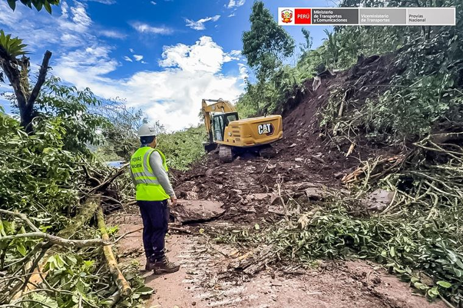
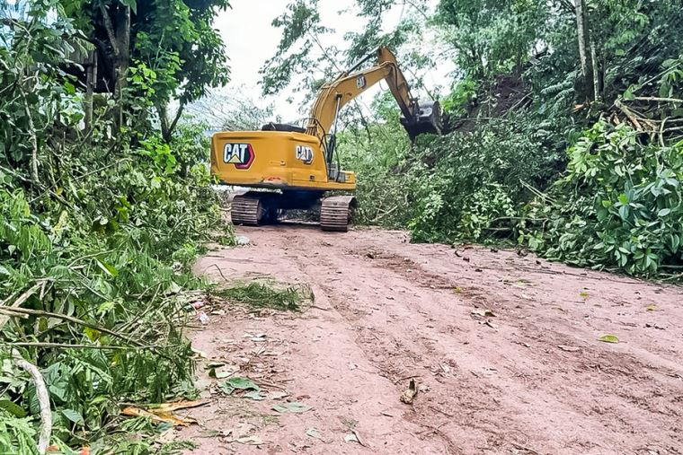
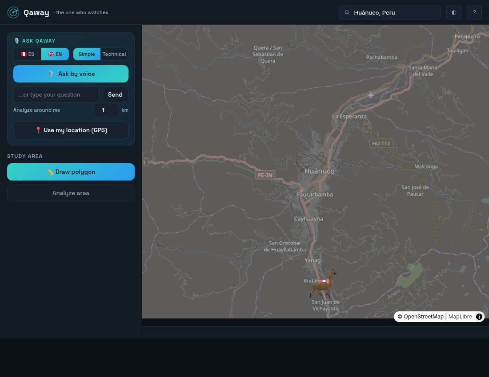
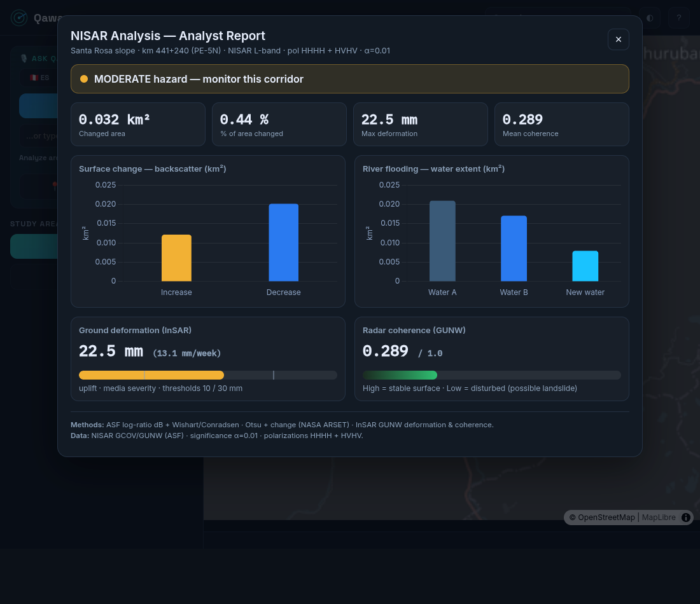

# 🦙 Qaway — *"the one who watches"*

**Voice-first NISAR radar alerts for the dangerous roads of the Peruvian Andes and jungle.**

NASA Space Apps Challenge 2026 · Challenge: *Dancing with the SARs* (NISAR)
Team **thecreator** — Lino Ever Ramos Maíz · Silvana Rossío Pacheco Malpartida

🔗 **Live demo:** https://qaway.thecreatorcampus.ai  ·  💻 **Code:** this repository

---


<sub>A Provías Nacional worker and an excavator clear the landslide that buried the Federico Basadre highway at Santa Rosa, Padre Abad, Ucayali. **Photo: Provías Nacional / MTC, via El Peruano (1 Nov 2026).**</sub>

---

## 1. A real emergency — 1 November 2026, 3 a.m.

In the early morning of **Sunday, 1 November 2026**, a landslide came down onto the
**Federico Basadre highway (PE-5N)**, at the sector **Santa Rosa / Alto Oriental**, near
**Puente Chino**, district of **Boquerón**, province of **Padre Abad**, region of **Ucayali**.
Approximate point of the slide: **km 441+240** — coordinates **-9.085457, -75.731236** (WGS84).

What the slide left behind:

- **~140–200 meters of road buried** under mud, rocks and uprooted trees.
- **Heavy-cargo trucks damaged**; drivers and passengers **stranded since the night before**
  by a first slide on the same road.
- The highway is the **main land link between Huánuco and Pucallpa**, so the cut also
  **threatened fuel supply to Pucallpa** (Petroperú activated contingency logistics).
- **Provías Nacional (Unidad Zonal Ucayali)** deployed front loaders, dump trucks and
  excavators, bringing machinery from Tingo María to work from both ends.
- No deaths or injuries were reported — but it was luck as much as anything.


<sub>The highway, buried in a jungle corridor. **Photo: Provías Nacional / MTC, via El Peruano (1 Nov 2026).**</sub>

This is not a rare event. These roads, carved into steep, rain-soaked Andean and
high-jungle slopes, slide **every rainy season**. A driver rounding a curve at 3 a.m. has
**no way of knowing** whether the hillside ahead has already come down.

> **Sources:** [El Peruano](https://elperuano.pe/noticia/308102-ucayali-mtc-despliega-maquinaria-para-liberar-via-federico-basadre-tras-caida-de-huaico) ·
> [El Búho](https://elbuho.pe/?p=442055) ·
> [Gestión](https://gestion.pe/peru/huaico-bloquea-tramo-de-carretera-federico-basadre-noticia/) ·
> [Canal N](https://canaln.pe/actualidad/ucayali-mtc-despliega-nueve-maquinas-despejar-deslizamiento-carretera-jorge-basadre-n495999) ·
> aerial footage: [YouTube](https://www.youtube.com/watch?v=eGZc7My_xcA)

---

## 2. The gap

NASA–ISRO's **NISAR** satellite sees these slopes through clouds, rain and darkness, in
L-band radar. The data to watch this highway **exists and is open**. But:

- It lives in scientific archives (HDF5 granules, hundreds of MB), unreachable to a driver.
- Reading it needs remote-sensing expertise most people — and most local authorities — don't have.
- A truck driver doesn't need a coherence map. They need to know: **"is the road ahead safe,
  yes or no, and what do I do?"**

**Qaway closes that gap.** It turns NISAR radar into a spoken answer for the driver, and into
a rigorous statistical report for the analyst — two faces of the same engine.

---

## 3. Meet Qaway 🦙

**Qaway** (*"the one who watches"* in Quechua) is an open-source web app guided by a little
Andean llama mascot — wearing a red-and-white Peruvian blanket — that walks across the map
while it watches the road for you.


<sub>Qaway's mascot walks the map; the app is centered on the user's GPS location.</sub>

It detects **three life-threatening surface changes** along a road corridor, all from NISAR:

1. 🏔️ **Landslides that already happened** — surface change (log-ratio dB + Wishart/Conradsen test).
2. 📉 **Slow slope movement** — early warning, millimeters of ground motion (InSAR, GUNW).
3. 🌊 **River flooding / overflow** — new water detection (NASA ARSET Otsu + change method).

---

## 4. Two modes, one engine

### 🎙️ Driver mode — voice, hands-free
The driver asks out loud (*"is there any danger on my route?"*). An **AI agent** (an LLM with
tool-calling) decides which NISAR analysis to run, executes it over the road corridor, and
**answers by voice** — in Spanish or English, simple or technical. No screen, no jargon,
just *"there is danger — slow down / stop."*

### ✏️ Analyst mode — polygon, rigorous statistics (no voice)
An analyst draws a polygon over the exact slope. Qaway **does not speak** here — it opens a
**statistical report**: changed area, significance, backscatter increase/decrease, flood
extent, InSAR deformation (mm/week) and radar coherence, with a risk verdict, all from the
real pipeline.


<sub>Analyst mode, **real NISAR output for the Santa Rosa slope (km 441+240)** from October 2026 data:
change bars, flood bars, deformation and coherence gauges, and a hazard verdict computed from the
numbers — not from the LLM. Verdict: *MODERATE — monitor this corridor.*</sub>

---

## 5. This case, through Qaway

We pointed Qaway at the exact slope of the 1 November slide (**-9.085457, -75.731236**) and
**ran the real pipeline** on NISAR data from the two weeks *before* the collapse (passes of
**17 and 29 October 2026**, track 75 ascending, plus the GUNW interferometric pair).

**What NISAR showed on that slope, days before it fell:**

| Indicator (real NISAR output, Oct 2026) | Value |
|---|---|
| Ground deformation (InSAR, max) | **22.5 mm** (13.1 mm/week) |
| Slope area moving > 10 mm | **24.9 %** |
| Mean radar coherence | **0.289** (low) |
| Slope area with low coherence (< 0.3) | **61.7 %** |
| Hazard verdict (computed from the numbers) | **MODERATE — monitor this corridor** |

In plain terms: **a quarter of the hillside was already moving, and most of it had lost radar
coherence — the signature of a disturbed, unstable surface — before the 1 November collapse.**
This is exactly the early-warning signal Qaway is built to surface:

> *"With October data, Qaway already saw this slope moving and losing coherence — days before
> the landslide. It could have flagged the corridor to watch."*

**We state the limits honestly:**

- Single-pair InSAR deformation is an **indication**, not a certified measurement — a time
  series (SBAS) would confirm it.
- This is **dense jungle**: the low coherence (0.289) reflects **both** forest canopy **and**
  surface disturbance. Both readings point the same way — a perturbed slope — but we do not
  over-claim a single cause.
- We do **not** claim Qaway *predicted* the exact collapse. We show that, on real open NISAR
  data, the slope carried **measurable instability consistent with the landslide that followed.**
- The **post-event pass** that would image the fresh scar was not yet published on ASF at build
  time (radar archives have processing latency); when it appears, the same change + coherence
  tools reveal the scar directly.

We would rather show a real, reproducible result with its limits stated than a staged one.

---

## 6. How it works

```
Voice / polygon ──▶ /api/buscar (ASF, 2 latest NISAR passes)
                 ──▶ /api/analisis (download GCOV+GUNW, clip polygon)
                       ├─ change: log-ratio dB + Wishart/Conradsen  (ASF/NASA)
                       ├─ deformation: InSAR unwrapped phase → mm   (NISAR GUNW)
                       ├─ coherence: coherenceMagnitude 0–1         (NISAR GUNW)
                       └─ flooding: Otsu threshold + change         (NASA ARSET)
                 ──▶ driver: AI agent narrates by voice
                 ──▶ analyst: statistics dashboard on screen
```

**Stack:** Python · FastAPI · numpy/scipy/h5py/rasterio · `asf-search` · MapLibre GL · Turf.js ·
OpenStreetMap · Chart.js · Three.js (3D mascot) · an LLM agent (local Ollama/Qwen2.5, or Google
Gemini API to run without a GPU) · Docker · Cloudflare Tunnel.

**NASA data:** NISAR (NASA-ISRO) GCOV & GUNW via the **Alaska Satellite Facility (ASF)**;
method guidance from **NASA ARSET**. Terrain from **Copernicus GLO-30 DEM (ESA)**.

---

## 7. Status, honesty & links

**Works today (end-to-end, tested):** voice agent with tool-calling; three-hazard analysis on
real NISAR data; draw-a-polygon analyst dashboard; GPS location; bilingual ES/EN; Docker +
Cloudflare Tunnel deployment; walking 3D mascot.

**Honest limits:** needs internet today (offline-first is a designed next step); single-pair
InSAR deformation is reported as an **indication**, not a certified measurement (a time series
would confirm it); flood detection is reliable on open rivers, harder under dense canopy or in
cities; the live demo runs on a self-hosted server and is reachable while it is powered on.

**Not claimed:** we do not claim to have imaged the 1 Nov landslide scar — the post-event NISAR
scene was not yet available; this README presents the real case, the real coverage, and the
honest workflow.

| | |
|---|---|
| 🔗 Live demo | https://qaway.thecreatorcampus.ai |
| 💻 Source | this repository |
| 🛰️ NISAR / ASF | https://search.asf.alaska.edu/ · https://asf.alaska.edu/ |
| 📚 NASA ARSET | https://appliedsciences.nasa.gov/what-we-do/capacity-building/arset |

**Credits:** news photographs © **El Peruano / Provías Nacional (MTC)**, used here for
journalistic illustration with attribution; 3D llama model by **Quaternius (CC0)**; base map
© **OpenStreetMap** contributors. All other code and figures are the team's own work.

*Built for NASA Space Apps 2026. AI tools (Qwen2.5/Gemini as the in-app agent, and an AI
assistant for coding and this write-up) were used and are disclosed in the submission.*
