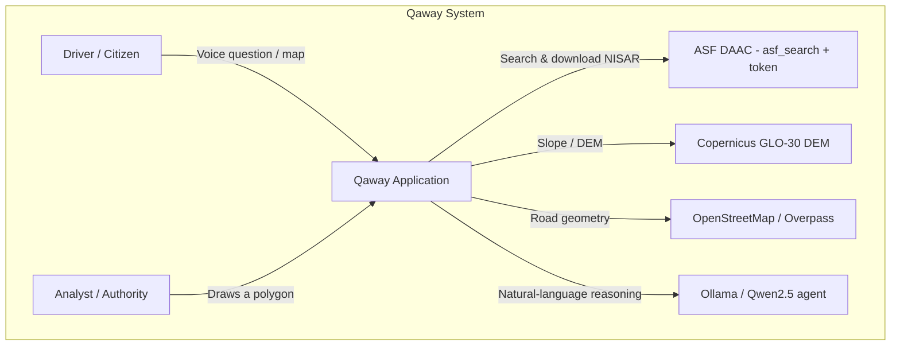

## Business Case

> **Product:** **Qaway** — *"the one who watches" (Quechua)*.
> **Challenge:** NASA Space Apps Challenge 2026 — **"Dancing with the SARs"** (NISAR).
> This document captures the architectural drivers (ADD method). **Status markers reflect the
> as-built system:** ✅ = implemented · 🔮 = designed / future work.

In the Peruvian Andes, roads are repeatedly cut by **landslides** and **river floods** after the
rains, isolating rural communities. The risk data exists but **never reaches the person driving,
in time**. SAR radar (NISAR, **L-band**) measures surface change and movement **day or night,
through clouds and under vegetation**, giving both **after-the-fact mapping** and **early-warning**
(slopes deform mm/week *before* they fail).

**Qaway** is an open-source web app that turns NISAR radar into **spoken, actionable road-hazard
alerts**. It detects **three surface-change hazards** — landslides (already moved), slow slope
movement (early warning) and river flooding — delivered through an **agentic AI voice assistant**.

The project is built for the hackathon, so a **working, demonstrable MVP** is the dominant
constraint. It is **open-source** and runs on the author's **self-hosted server** (Docker +
Cloudflare Tunnel).

## System Requirements

### Primary functionality (as-built)
| User story | Description | Status |
|---|---|---|
| SV-1: Ask by voice | A driver asks in natural language (ES/EN); the agent decides the analysis and **answers by voice**. | ✅ |
| SV-2: Draw a polygon | An analyst draws an area on the map; Qaway analyzes exactly that zone and reports the result. | ✅ |
| SV-3: Analyze a new area | The system auto-picks the 2 latest NISAR passes, runs an async download+process job, reports progress, caches the result. | ✅ |
| SV-4: Detect landslide (occurred) | Change detection (log-ratio + Wishart) flags where a slope already moved. | ✅ |
| SV-5: Early warning (slow movement) | InSAR displacement (GUNW) measures mm/week movement before collapse. | ✅ |
| SV-6: Detect river flooding | Otsu water threshold + change (NASA ARSET) flags new water / overflow. | ✅ |
| SV-7: Two depth levels, two languages | The same result is served simple (citizen) or technical (scientist), in ES or EN. | ✅ |
| SV-8: Risk read-out & physical reasoning | The agent explains the hazard and what to do, grounded in the real numbers + slope (DEM). | ✅ |
| SV-9: Time-series / animation, export/share, manage zones | Richer visualization, sharing and zone management. | 🔮 |

### Quality attribute scenarios
| ID | Quality Attribute | Scenario | Status |
|---|---|---|---|
| QA-1 | Performance (processing) | Analysis of a drawn area completes in ~1–2 s once data is local (crop-only window). | ✅ |
| QA-2 | Responsiveness | A new-area request returns a job id quickly and streams progress; heavy work is off the request path. | ✅ |
| QA-3 | Usability | A non-expert understands stable / moving / flooding within a minute, by voice, no SAR knowledge. | ✅ |
| QA-4 | Modifiability (new hazard) | A new hazard is added as a new `processing/*.py` module + one agent tool, no core change (how floods were added). | ✅ |
| QA-5 | Reliability (agent) | The assistant answers consistently despite a flaky local 7B model (auto-retry on garbled tool calls). | ✅ |
| QA-6 | Interoperability | Integrates NISAR via `asf_search` (token) and serves results through the web map. | ✅ |
| QA-7 | Deployability | Deploys reproducibly on one self-hosted server (Docker + Cloudflare), open-source. | ✅ |
| QA-8 | Efficiency / Caching | A scene already downloaded is reused (LRU cache, 100 GB cap, demo pinned); not re-downloaded. | ✅ |
| QA-9 | Availability during demo | Public URL stays up during judging (depends on the PC + tunnel being on). | ⚠️ partial |
| QA-10 | Observability | Operator sees job state/history and system health. | 🔮 |

### Constraints
| ID | Constraint | Status |
|---|---|---|
| CON-1 | Use **NISAR** radar as primary data source. | ✅ (GCOV + GUNW) |
| CON-2 | **Open-source.** | ✅ |
| CON-3 | **Self-hosted** on the author's server; no paid cloud. | ✅ |
| CON-4 | SAR obtained via **ASF** (Earthdata token, `asf_search`). | ✅ |
| CON-5 | **Web browser**, cross-platform, broad non-expert audience. | ✅ |
| CON-6 | Demonstrable **MVP within the hackathon window**. | ✅ |
| CON-7 | **Free / local LLM** (no API cost, data stays on the PC). | ✅ (Ollama/Qwen2.5) |

### Architectural concerns
| ID | Concern |
|---|---|
| CRN-1 | Establish an overall system structure (greenfield). |
| CRN-2 | Mitigate InSAR decorrelation over vegetation → favour L-band and robust change metrics; be explicit about where results are reliable. |
| CRN-3 | Keep heavy SAR processing **off the request path** (async jobs, caching). |
| CRN-4 | Keep the system **modular** so a new hazard = new module + tool. |
| CRN-5 | Design the **AI agent layer** (Ollama/Qwen2.5) so it does not couple to or destabilize the core pipeline. |

## Priorities
Primary drivers for the architecture: **SV-1 (voice), SV-2 (polygon), SV-3 (analyze new area),
QA-1 (performance), QA-4 (modifiability), QA-5 (reliability)**, together with constraints CON-1..CON-7.

## Not implemented (future work)
- 🔮 **Offline-first alerting** (pre-cache route + on-device alert without signal) — designed, not built.
- 🔮 **Durable jobs** (Redis/Postgres) — jobs are currently in memory (lost on restart).
- 🔮 **Time-series deformation** (JPL dolphin / SBAS, GPU) — current deformation is a single pair (indicative).
- 🔮 **Export/share, manage zones, observability dashboard.**
