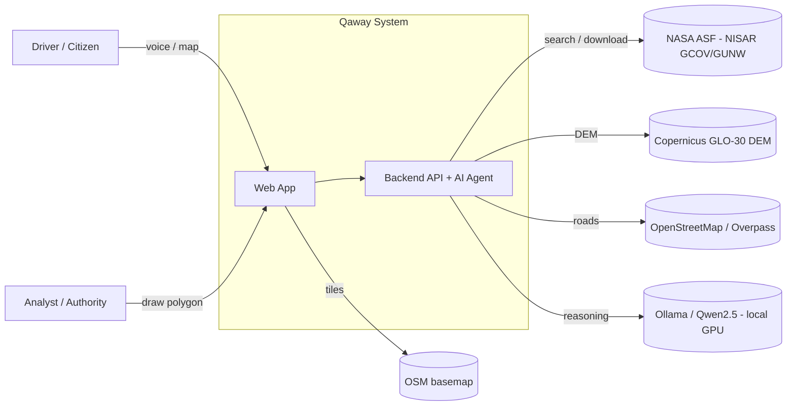
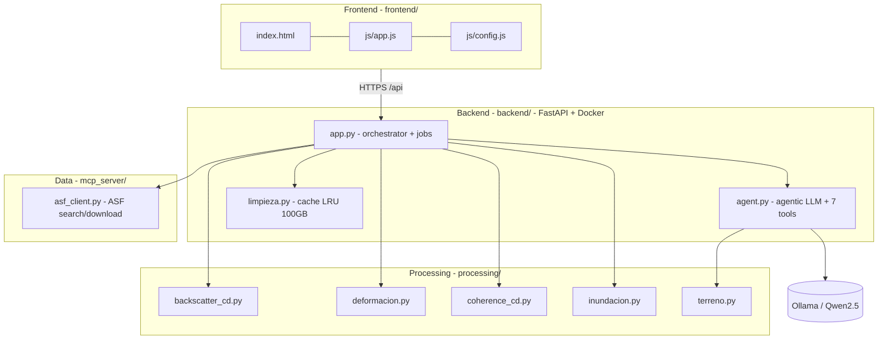
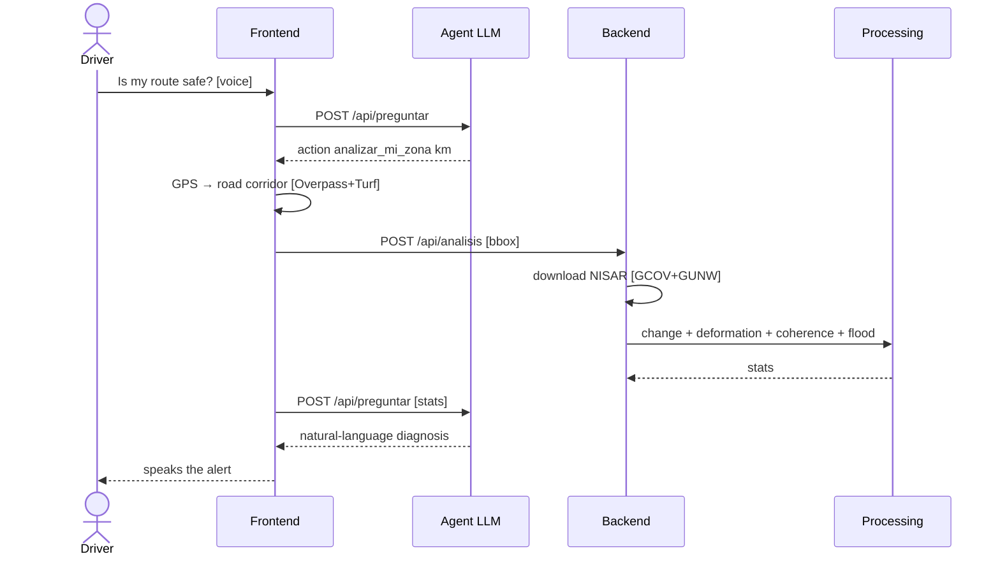
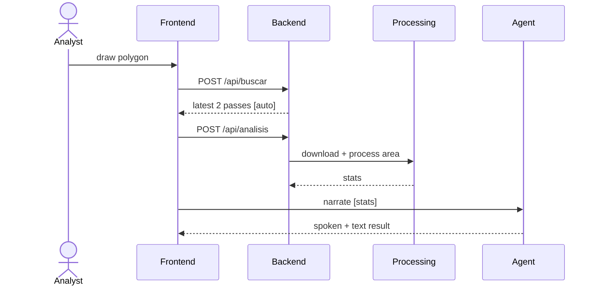

# Qaway — Architecture Document

> Follows the Attribute-Driven Design (ADD) method. As-built, coherent with the source code
> in `spaceapps/sarvigia/`. (Product renamed SARvigía → **Qaway**; folder `sarvigia/` kept.)

## 1. Introduction
Qaway is an open-source web app that turns **NISAR (NASA–ISRO)** radar into **spoken, actionable
road-hazard alerts** for the Peruvian Andes. It detects three surface-change hazards along roads —
**landslides**, **slow slope movement** (early warning) and **river flooding** — and delivers them
through an **agentic LLM voice assistant**. Drivers and quality attributes are defined in
`../ArchitecturalDrivers.md`; the iteration plan in `IterationPlan.md`.

## 2. Context Diagram

## 3. Architectural Drivers (summary)
**User stories:** (US-1) driver asks by voice and hears a hazard alert; (US-2) analyst draws an
area and gets a report; (US-3) ask in Spanish/English, simple or technical.
**Quality attribute scenarios:** (QA-1 Modifiability) add a new hazard with minimal change;
(QA-2 Performance) analysis of a drawn area in seconds once data is local; (QA-3 Reliability)
the assistant answers consistently despite a flaky local model; (QA-4 Usability) one data source
served to several audiences.
**Constraints:** use NASA/NISAR data; open-source; self-hosted on the team's PC; free/local LLM.

## 4. Module / Container Diagram

### Component responsibilities
| Component | File(s) | Responsibility |
|---|---|---|
| Frontend | `frontend/*` | Map, voice mode + polygon mode, GPS corridor, ES/EN + simple/technical, calls `/api`. |
| Orchestrator | `backend/app.py` | `/health /buscar /analisis /jobs /preguntar`; async download+process jobs. |
| AI Agent | `backend/agent.py` | Agentic loop (Qwen2.5) with tool-calling; decides analysis; narrates. |
| Cache cleanup | `backend/limpieza.py` | LRU eviction, 100 GB cap, pins demo scenes. |
| Data access | `mcp_server/asf_client.py` | Search & download NISAR GCOV/GUNW from ASF. |

> Note: the folder is named `mcp_server/` for historical reasons (an early MCP prototype),
> but at runtime it is used as a plain Python module — **Qaway does not run the MCP protocol**.
> The AI reasoning is the local **Ollama/Qwen2.5 agent** with its own tool-calling.
| Processing | `processing/*.py` | One module per analysis (change, deformation, coherence/fusion, flood, slope). |

## 5. Sequence Diagrams

### SEQ-1 · Voice mode (driver)

### SEQ-2 · Polygon mode (analyst)

## 6. Algorithms (per hazard)
| Hazard | Module | Method | Backing |
|---|---|---|---|
| Landslide (occurred) | backscatter_cd | Log-ratio dB + Wishart/Conradsen (α) | ASF NISAR Cookbook; IEEE TGRS 2003/2016 |
| Slow movement (early warning) | deformacion | InSAR phase → LOS mm, −(λ/4π)·φ | NISAR Landslides white paper (JPL) |
| Confidence | coherence_cd | Coherence threshold + fusion | CCD literature |
| River flood | inundacion | Otsu threshold + change | NASA ARSET flood mapping |
| Susceptibility | terreno | DEM slope gradient | Copernicus GLO-30 |

## 7. Technology stack
MapLibre GL 4.7, Turf.js 6.5, Web Speech API, OSM/Overpass · FastAPI, asf_search, h5py, numpy,
scipy, pyproj, rasterio, Pillow · Ollama + Qwen2.5-7B (local GPU) · Docker + Cloudflare Tunnel
(`qaway.thecreatorcampus.ai`).

## 8. Design Decisions (ADD Step 6)
| Driver | Decision | Rationale | Discarded alternatives |
|---|---|---|---|
| QA-1 Modifiability | **One processing module + one agent tool per hazard** | Adding a hazard touches only new files (flood added this way) | Monolithic analysis function (hard to extend) |
| US-1 / US-3 (voice, NL) | **Agentic LLM with tool-calling (Qwen2.5)** decides the analysis | Handles any phrasing/language; not a fixed menu | Rule-based intent parser (brittle, template-like) |
| Constraint: free/local, privacy | **Ollama local LLM on the team GPU** | No API cost, private, reuses existing infra | Cloud LLM API (cost, key, data leaves PC) |
| QA-2 Performance | **Crop only the polygon window from the HDF5** | Reads MBs not GBs → ~1–2 s processing | Process full 330 km scene (slow, memory-heavy) |
| QA-3 Reliability (LLM) | **Auto-retry on garbled tool calls** | Local 7B model occasionally leaks malformed calls | Trust single call (≈50% fail observed) |
| Constraint: self-host, no app store | **PWA-style web app + Cloudflare Tunnel** | Public URL, no install, judges just open the link | Native Android app (install friction, one platform) |
| Disk growth | **LRU cache cleanup (100 GB), pin demo** | Bounds disk while keeping repeat areas instant | Keep everything (disk fills) / delete all (re-download) |
| Data freshness | **Always re-search ASF, auto-pick 2 latest passes** | A month later uses the newer dates automatically | Hard-code dates (stale) / manual date menu (friction) |

## 9. Analysis (ADD Step 7)
| Driver | Analysis result |
|---|---|
| US-1 Voice alert | **Satisfied** — voice→agent→analysis→spoken result works end-to-end. |
| US-2 Polygon report | **Satisfied** — draw→buscar→analisis→narration works. |
| US-3 ES/EN + levels | **Satisfied** — toggles drive both answer language and depth. |
| QA-1 Modifiability | **Satisfied** — three hazards added as independent modules + tools. |
| QA-2 Performance | **Satisfied** (processing) — ~2 s; download is the only slow step (cached after). |
| QA-3 Reliability | **Partially satisfied** — auto-retry added; deformation is single-pair (indicative). |
| QA-4 Usability | **Satisfied** — two modes, two languages, two depth levels. |

## 10. Known limits / future work
- Deformation: single interferometric pair = indicative; a time series (JPL **dolphin**/SBAS, GPU) would confirm.
- Urban-dense flooding is hard for threshold methods (reliable for open water / rivers).
- Offline-first alerting (pre-cache route + on-device alert) is **designed, not yet built**.
- Jobs are in memory (lost on restart) → move to Redis/Postgres for durability.
